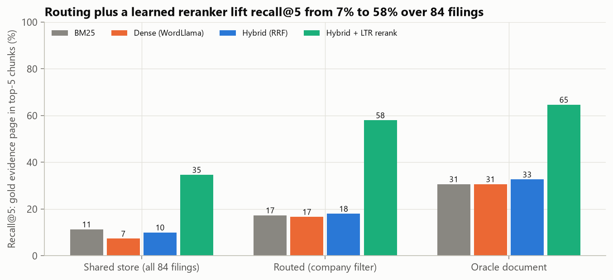
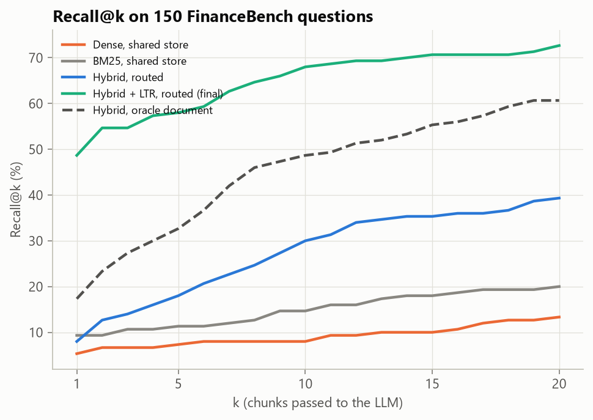
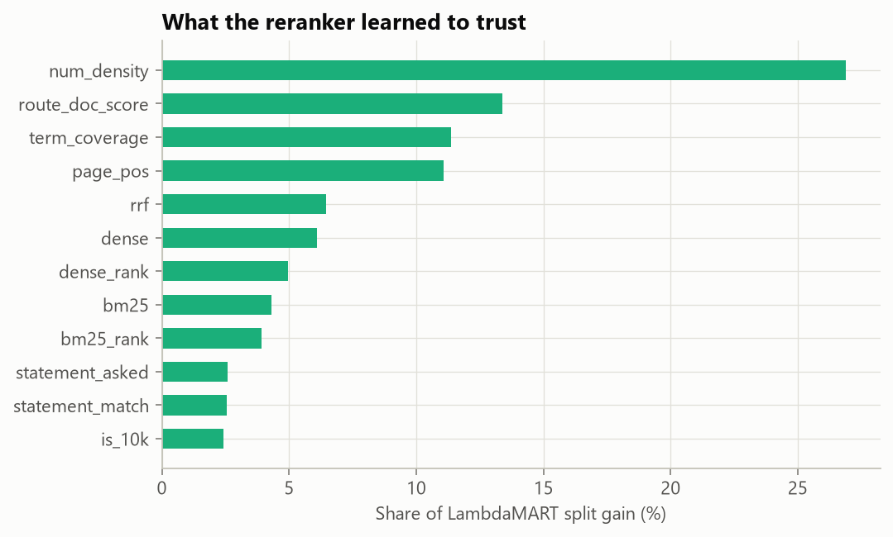

# Finding the evidence: retrieval for question answering over SEC filings (FinanceBench)

  

LLMs answer questions about financial filings badly when they are handed the wrong pages. The [FinanceBench](https://arxiv.org/abs/2311.11944) authors found that GPT-4-Turbo with a shared vector store got **81%** of questions wrong or refused them. This project treats retrieval as the problem to solve. It builds a CPU-only pipeline over 84 real 10-Ks, 10-Qs, 8-Ks and earnings releases (12,013 pages) and measures, page by page, how often the evidence an analyst marked actually reaches the model.

**Result:** the share of questions whose gold evidence page lands in the top 5 retrieved chunks rises from **7%** (embeddings over all filings, the common default) to **58%** (metadata routing plus a learned reranker). That beats plain hybrid search even when it is handed the *correct filing* (33%). For questions about financial-statement metrics, recall@5 reaches **96%**.



## Results at a glance

| System (top-5 chunks of 300 words) | Recall@1 | Recall@5 | Recall@10 | MRR@20 |
|---|---|---|---|---|
| Dense embeddings, all 84 filings (naive baseline) | 5.3% | 7.3% | 8.0% | 0.066 |
| BM25, all filings | 9.3% | 11.3% | 14.7% | 0.107 |
| Hybrid (BM25 + dense, RRF), all filings | 6.0% | 10.0% | 15.3% | 0.088 |
| Hybrid, **routed** to the company's filings | 8.0% | 18.0% | 30.0% | 0.139 |
| Hybrid, oracle filing (told the right document) | 17.3% | 32.7% | 48.7% | 0.259 |
| **Routed hybrid + learned reranker (final)** | **48.7%** | **58.0%** | **68.0%** | **0.541** |
| Oracle filing + learned reranker (ceiling check) | 48.7% | 64.7% | 76.0% | 0.562 |

95% Wilson interval for the final recall@5 (n = 150): about 50% to 66%.

| Question type (50 each) | Naive recall@5 | Final recall@5 |
|---|---|---|
| Metrics from financial statements ("FY2018 capex from the cash-flow statement") | 0% | **96%** |
| Domain questions ("Is 3M capital-intensive?") | 0% | 36% |
| Novel analyst questions | 22% | 42% |

Retrieval latency is about 3 ms per query (BM25 and embedding scoring over 30,966 chunks). Indexing all 84 filings takes under a minute on a laptop CPU.

## Why the naive setup fails

Every filing talks about revenue, operating margin, cash and risk. In a shared index, a question about *3M's* FY2018 capex retrieves capex discussion from 20 other companies. The question names the company and the period, but similarity search does not treat those as constraints. Three fixes, in order of impact:

1. **Route before you retrieve.** A deterministic parser reads the company (with aliases such as "AMEX" and "JnJ") and the fiscal period ("FY20", "Q2 of FY2024", "FY2023Q1") from the question. It identifies the company for **98%** of questions and ranks the gold filing first for **87%**. Only three questions do not name a company at all.
2. **Retrieve wide, then rerank.** Take the top 150 BM25 and top 150 dense chunks inside the routed filings; 87% of questions have a gold chunk in that pool. Rank-fusion alone cannot surface it, because the right page looks lexically ordinary.
3. **Learn what an evidence page looks like.** A LambdaMART reranker uses 16 interpretable features. It learns that answers live on number-dense statement pages in the right filing and period, which embeddings do not encode.



## Approach

```
84 PDFs ──PyMuPDF──> 12,013 pages ──> 30,966 chunks (300 words, 100 overlap, never crossing a page)
                                        │
question ──> router (company, years, quarter) ──> document filter + per-document period score
                                        │
              BM25 (bm25s, stemmed)  +  dense (WordLlama, 256-d)  ──> top-150 each, RRF fused
                                        │
              LambdaMART reranker (16 features, company-grouped CV) ──> top-5 chunks with (filing, page)
```

### Key design decisions

| Decision | Why | Alternative considered |
|---|---|---|
| **Evaluate retrieval at the page level against FinanceBench's annotated evidence pages** | Retrieval quality is measurable without an LLM, cheaply and deterministically, and it caps end-to-end accuracy. | Judging only final answers (expensive, noisy, and hides *why* a system fails) |
| **Chunks never span pages** | Every retrieved chunk maps to exactly one citable (filing, page). | Token windows across pages (better recall, broken citations) |
| **Rule-based router** | 98% company accuracy with zero training data and fully explainable failures. | An LLM query parser (extra latency and cost for little gain on this corpus) |
| **Reranker trained with company-grouped 5-fold CV** | No company's filings are seen during training and evaluation of the same fold, so the reranker cannot memorise a filing's layout. | Random-split CV (leaks filing-specific patterns) |
| **Static embeddings (WordLlama)** | Runs on any laptop with no GPU and no model download beyond a pip install. A transformer encoder drops in by changing `Dense._encode`. | MiniLM or BGE encoders (stronger semantics, need model downloads) |

### What the reranker learned



Numeric density is the strongest signal (27% of split gain), followed by the router's per-filing period score (13%), query-term coverage (11%) and position in the document (11%). The raw BM25 and dense scores together contribute under 21%: lexical and semantic similarity are needed to build the candidate pool but are weak at ordering it.

## Try it

```bash
python scripts/ask.py "What is the FY2018 capital expenditure amount (in USD millions) for 3M?"
```

## Limitations

- **150 questions.** The open-source FinanceBench sample is small; differences under about 8 percentage points are within noise.
- **Reranker features fit this question style.** Statement-page cues help metric questions most. Domain and novel questions (36% to 42% recall@5) need deeper semantic matching, which is where a transformer encoder or cross-encoder would add the most.
- **PDF text only.** Tables are read as flattened text. Layout-aware parsing would help the remaining statement-page misses.
- **Routing assumes the question names the company.** Three questions do not, and those fall back to the full corpus.

## Reproduce

```bash
python -m venv .venv && source .venv/bin/activate     # Windows: .venv\Scripts\activate
pip install -r requirements.txt
python scripts/download_data.py          # FinanceBench questions + the 84 referenced PDFs (~160 MB)
python scripts/run_retrieval_eval.py     # ~5 min on CPU; writes reports/ and data/processed/
pytest -q
```

## Repository structure

```
src/finrag/
  corpus.py      PDF -> pages -> page-bounded chunks; questions with gold (filing, page) sets
  router.py      company / fiscal-period parser and per-filing scores
  retrievers.py  BM25 (bm25s), dense (WordLlama), top-k with masks, reciprocal rank fusion
  rerank.py      16 finance-aware features, LambdaMART with company-grouped CV
  evaluate.py    page-level recall@k and MRR
  pipeline.py    production path: route -> hybrid candidates -> rerank
scripts/         download_data.py, run_retrieval_eval.py, ask.py
tests/           router, fusion, chunking, features, metrics
reports/         figures/, tables/, RESULTS.md, metrics.json
```

## References

- Islam, P. et al. (2023). *FinanceBench: A New Benchmark for Financial Question Answering.* arXiv:2311.11944. Data: [patronus-ai/financebench](https://github.com/patronus-ai/financebench) (CC-BY-NC-4.0).
- Cormack, G., Clarke, C. & Buettcher, S. (2009). *Reciprocal rank fusion outperforms Condorcet and individual rank learning methods.* SIGIR.
- Burges, C. (2010). *From RankNet to LambdaRank to LambdaMART: An overview.* Microsoft Research.
